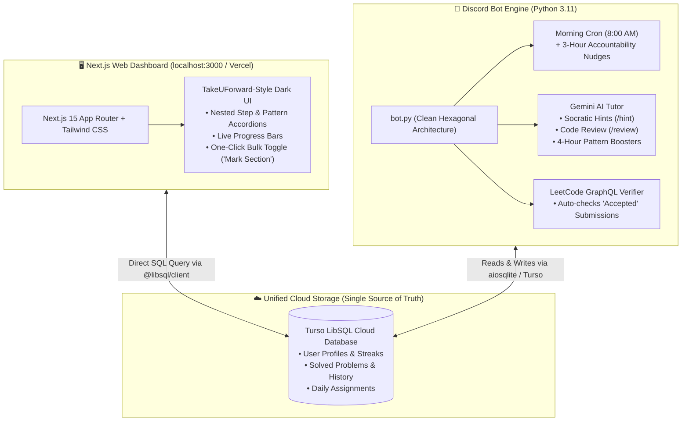

# 🎯 Striver's A2Z DSA Mentor & Cloud Tracker

A comprehensive, production-grade DSA learning ecosystem that bridges **Discord accountability** with a **modern Next.js dark-mode web dashboard**, backed by a cloud-synced **Turso (LibSQL) database** and **Google Gemini AI**.

Built following **Clean Hexagonal Architecture**, it tracks your progress through all 402 problems of **Striver's A2Z DSA Sheet**, verifies submissions directly against **LeetCode**, schedules spaced repetition reviews, and keeps you disciplined with automated morning challenges and accountability nudges.

---

## 🏛️ System Architecture



---

## ✨ Key Features

### 1. 🤖 Discord Accountability Bot
* **Automated Morning Delivery**: Posts your daily problem challenge every morning at your designated time (default: 8:00 AM) in `#daily-problems`.
* **Zero Password LeetCode Verification**: Click **`[⚡ Verify LeetCode]`** and the bot queries LeetCode's public GraphQL endpoint to check if an `Accepted` submission exists on your profile.
* **"Never Skip an Unfinished Problem" Rule**: If you miss today's challenge, the bot will not skip it. It repeats it the next morning and flags it as unfinished until conquered.
* **3-Hour Accountability Nudges**: Sends gentle reminders in `#daily-problems` every 3 hours if today's challenge remains pending.
* **4-Hour AI Pattern Boosters**: Automatically delivers high-yield pattern flashcards (key invariants, interview traps, and mental exercises) directly into `#pattern-notes`.
* **Flexible Pacing**: Run `/next` anytime to grab the next problem immediately, or `/next-pattern` to fast-track whole sections.
* **Extra Pattern Drills (`/extra`)**: Pulls 2–3 bonus practice questions matching your current active pattern from LeetCode.

### 2. 🖥️ Next.js Web Dashboard
* **TakeUForward-Inspired Dark Theme**: Built with Next.js 15, Tailwind CSS, and Google Font **Poppins** for a smooth, high-contrast dark aesthetic (`#0D0F17`).
* **Nested Collapsible Accordions**: Browse all 19 Steps and 69 Subtopics/Patterns cleanly.
* **Instant Single & Bulk Updates**: Toggle individual checkboxes, or click **`[ Mark Section ]`** / **`[ Mark Step Done ]`** to check off whole chapters in 1 second.
* **Real-time Cloud Sync**: Every checkmark immediately updates Turso and synchronizes with your Discord bot.
* **Search & Filters**: Instantly filter problems by `All`, `Solved`, or `Unsolved`, or search by problem title/slug.

---

## 📁 Project Structure

```text
DiscordBot/
├── core/                         # 1. Pure Domain Core (Framework-Agnostic)
│   ├── models/                   # Dataclasses: Problem, PatternNote, UserProfile
│   ├── interfaces/               # Abstract Ports (Contracts)
│   │   ├── problem_source.py     # IProblemSource
│   │   ├── verifier.py           # ISubmissionVerifier
│   │   ├── repository.py         # IProgressRepository
│   │   └── ai_tutor.py           # IAITutor
│   └── services/                 # Business Logic
│       ├── study_manager.py      # Pattern progression & carry-over logic
│       ├── streak_service.py     # Streaks & spaced repetition rules
│       └── event_bus.py          # Pub/sub event dispatcher
│
├── infrastructure/               # 2. Pluggable Adapters
│   ├── database/                 # SQLiteRepository (SQLite & Turso LibSQL)
│   ├── sources/                  # StriverSheetAdapter, LeetCodeAdapter
│   ├── verifiers/                # LeetCodeVerifier (GraphQL submission checker)
│   └── ai/                       # GeminiAdapter (Google Gemini 2.0 Flash)
│
├── discord_app/                  # 3. Discord Presentation Layer
│   ├── cogs/                     # StudyCog, NotesCog, AICog, ProfileCog, SchedulerCog
│   └── views/                    # ProblemCardView (buttons), NotesView (cheat sheets)
│
├── dashboard/                    # 4. Next.js Web Presentation Layer
│   ├── app/                      # Next.js 15 App Router (page.tsx, layout.tsx, APIs)
│   │   └── api/progress/         # REST API for progress & bulk updates
│   ├── data/striver_a2z.json     # 402 curated Striver problems dataset
│   ├── lib/db.ts                 # Turso LibSQL client configuration
│   └── .env.example              # Frontend environment variables template
│
├── mcp_server/                   # 5. IDE Presentation Layer (Model Context Protocol)
│   └── server.py                 # Tools for Antigravity, Cursor, and VS Code
│
├── data/                         # Data & Curated Knowledge
│   ├── striver_a2z.json          # Complete 402 problem dataset with video/article links
│   └── pattern_notes.json        # Curated blueprints, templates, and interview traps
│
├── config.py                     # Environment variables loader
├── bot.py                        # Dependency Injection Root & Bot Runner
├── inspect_db.py                 # Terminal utility to inspect database state
├── requirements.txt              # Python dependencies
├── .env.example                  # Backend environment variables template
└── .gitignore                    # Protects secrets and build artifacts
```

---

## 🎮 Discord Slash Commands Reference

### 📚 Study & Pattern Progression
| Command | Description |
| :--- | :--- |
| `/daily` | Get today's scheduled problem card with interactive buttons |
| `/next` | Fast-track: Grab the next problem in sequence right now |
| `/next-pattern` | Skip remaining problems and jump straight to the next pattern |
| `/extra` | Fetch 2–3 extra bonus drill problems on your active pattern from LeetCode |
| `/notes [pattern]` | Open the cheat sheet, mental model, and code template for a pattern |
| `/insight` | On-demand: Generate a fresh AI pattern flashcard right now |

### 🤖 AI DSA Tutor
| Command | Description |
| :--- | :--- |
| `/hint <approach>` | Get a Socratic hint tailored to your thoughts without spoiling the code |
| `/review <code>` | Analyze time/space complexity, edge cases, and optimization tips |
| `/ask <question>` | Explain any DSA concept with analogies and code snippets |

### 📊 Profile & Account
| Command | Description |
| :--- | :--- |
| `/progress` | Visual progress bar with overall sheet completion and step breakdown |
| `/set-handle <username>` | Link LeetCode handle for automatic submission verification |
| `/set-daily-channel` | Designate current channel for morning challenges and nudges |
| `/set-notes-channel` | Designate current channel for pattern cheat sheets & AI insights |
| `/set-time <hour> <min>` | Set daily notification time (e.g. `8 0` for 8:00 AM) |
| `/streak` | Check current daily solving streak and record streak |

---

## 🛠️ Getting Started

### Prerequisites
* **Python 3.10+**
* **Node.js 18+** & npm
* A free **Discord Bot Token** from [Discord Developer Portal](https://discord.com/developers/applications)
* *(Optional)* A free **Turso Database** from [turso.tech](https://turso.tech)
* *(Optional)* A free **Gemini API Key** from [Google AI Studio](https://aistudio.google.com/)

---

### 1. Backend Setup (Discord Bot)

1. **Clone the repository**:
   ```bash
   git clone https://github.com/your-username/dsa-mentor-bot.git
   cd dsa-mentor-bot
   ```

2. **Install Python dependencies**:
   ```bash
   pip install -r requirements.txt
   ```

3. **Configure Environment Variables**:
   Copy `.env.example` to `.env`:
   ```bash
   cp .env.example .env
   ```
   Fill in your tokens:
   ```env
   DISCORD_TOKEN=your_bot_token_here
   TURSO_DATABASE_URL=libsql://your-db.turso.io   # Leave empty to use local SQLite
   TURSO_AUTH_TOKEN=your_turso_auth_token_here
   GEMINI_API_KEY=your_gemini_key_here            # Optional for AI features
   DAILY_REMINDER_HOUR=8
   DAILY_REMINDER_MINUTE=0
   ```

4. **Start the Discord Bot**:
   ```bash
   python bot.py
   ```

---

### 2. Frontend Setup (Next.js Dashboard)

1. **Navigate to dashboard directory**:
   ```bash
   cd dashboard
   ```

2. **Install Node dependencies**:
   ```bash
   npm install
   ```

3. **Configure Environment Variables**:
   Copy `.env.example` to `.env.local`:
   ```bash
   cp .env.example .env.local
   ```
   Paste your Turso credentials:
   ```env
   TURSO_DATABASE_URL=libsql://your-db.turso.io
   TURSO_AUTH_TOKEN=your_turso_auth_token_here
   ```

4. **Run the Dashboard locally**:
   ```bash
   npm run dev
   ```
   Open **[http://localhost:3000](http://localhost:3000)** in your browser!

---

## 🚢 Deployment Guide

### Deploying Next.js Dashboard to Vercel
1. Push your repository to GitHub.
2. Go to [Vercel](https://vercel.com/) $\to$ **Add New Project** $\to$ Import your repo.
3. Set **Root Directory** to `dashboard`.
4. In **Environment Variables**, add:
   * `TURSO_DATABASE_URL`
   * `TURSO_AUTH_TOKEN`
5. Click **Deploy**!

### Deploying the Discord Bot to Cloud (Railway / Render / VPS)
1. Set the start command to:
   ```bash
   python bot.py
   ```
2. Add your environment variables (`DISCORD_TOKEN`, `TURSO_DATABASE_URL`, `TURSO_AUTH_TOKEN`, `GEMINI_API_KEY`).
3. Deploy as a persistent background worker process.

---

## 🤝 Contributing & License
Contributions, bug fixes, and feature requests are welcome!
Licensed under the [MIT License](LICENSE).
